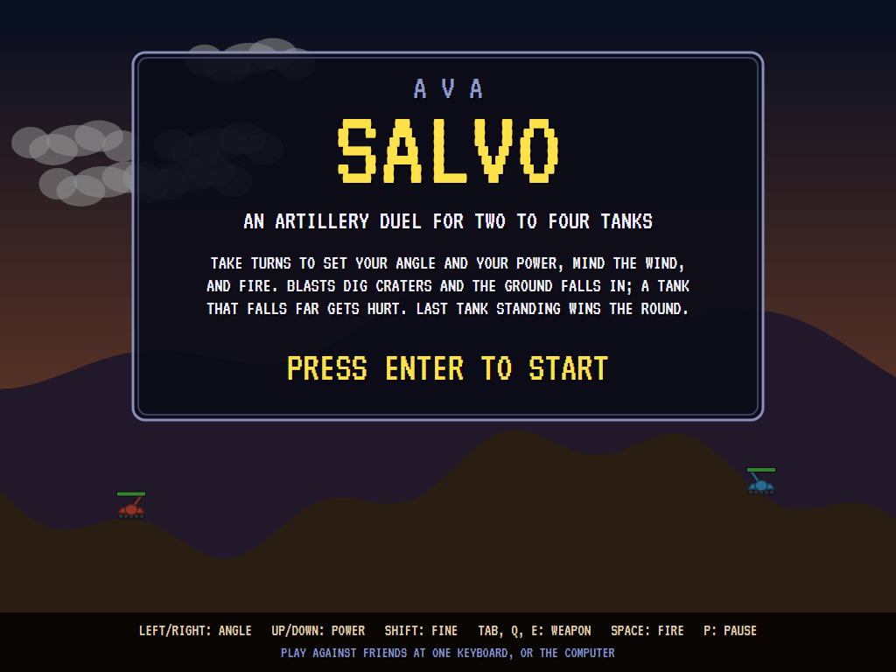
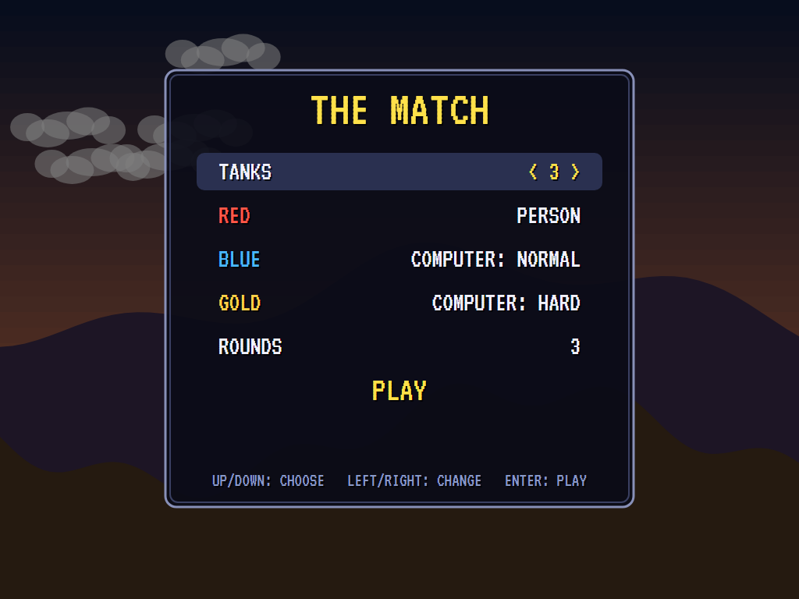
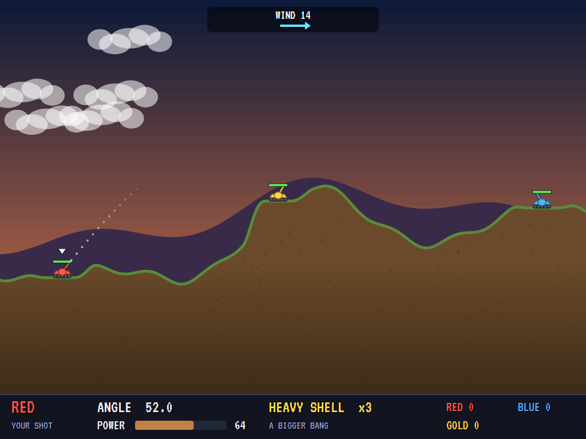
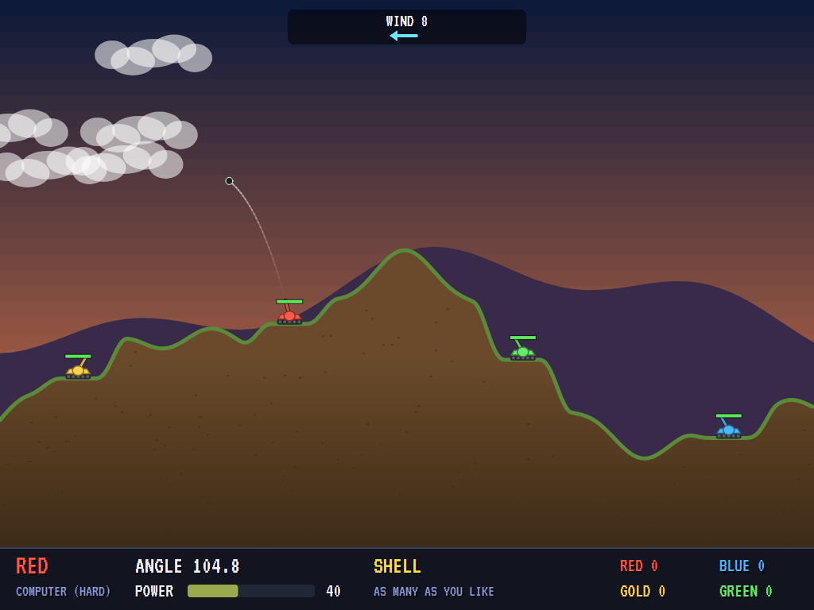
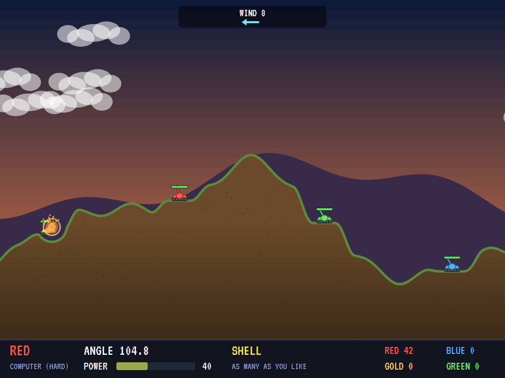
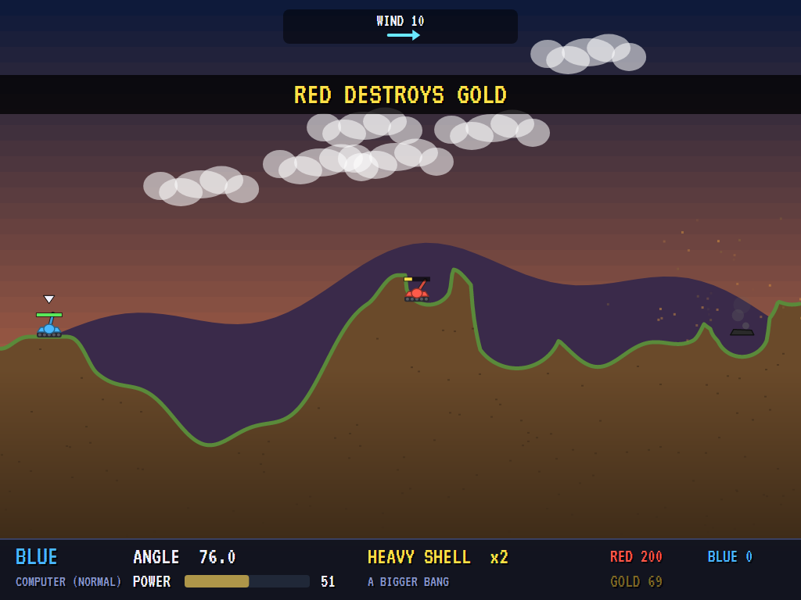
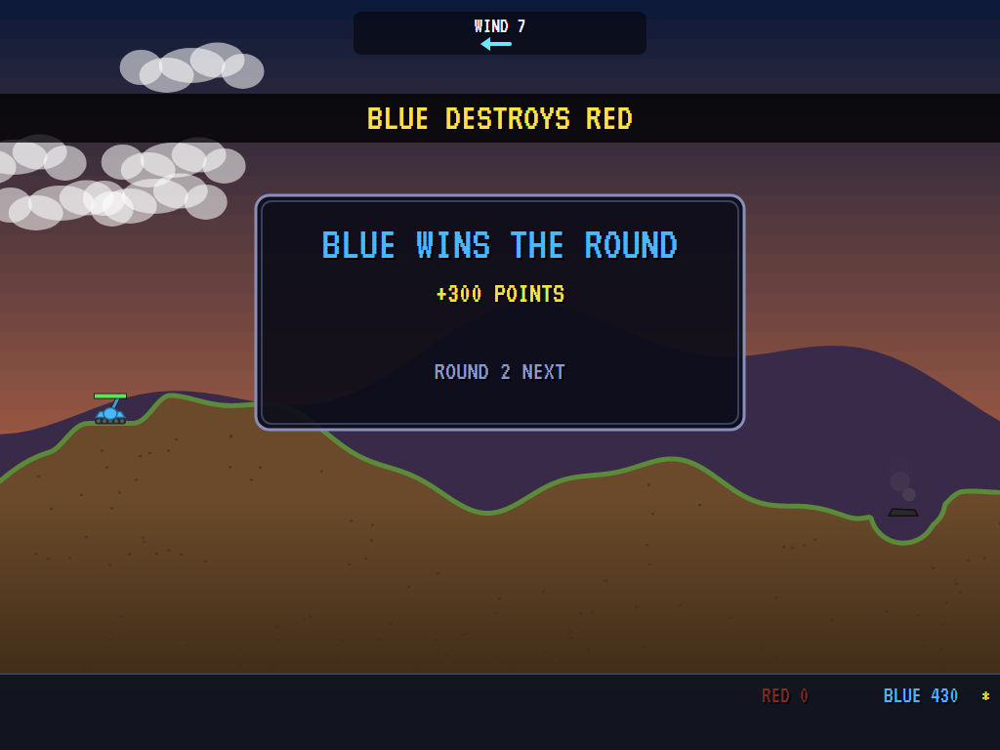
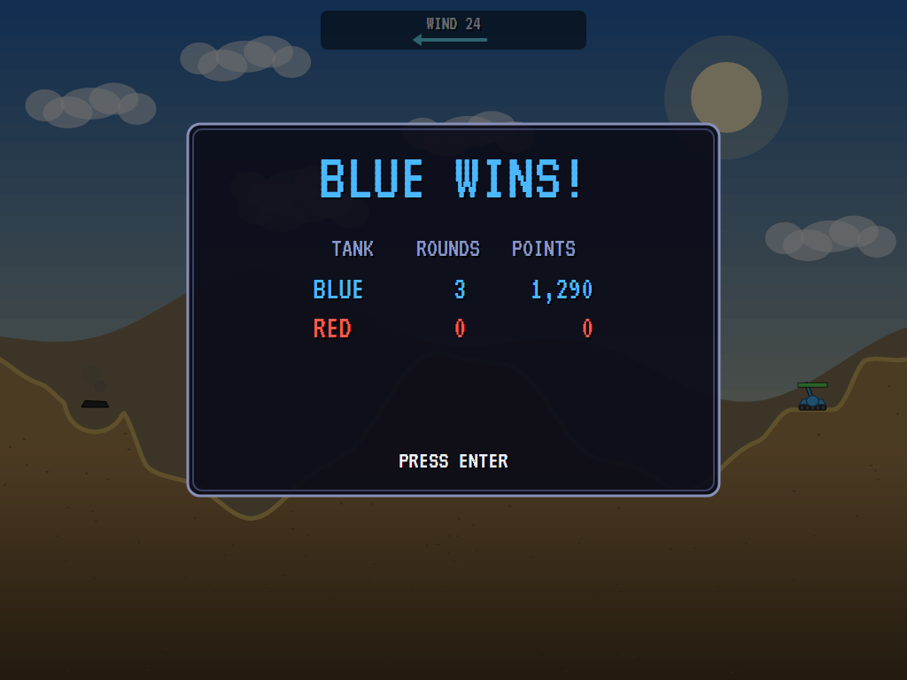
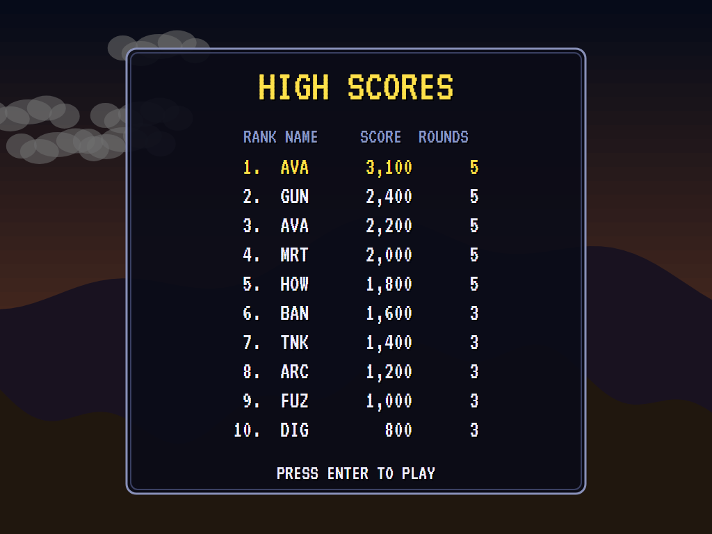

# AVA Salvo

An artillery duel for two to four tanks, in C# on .NET 10 and Avalonia 12. Take turns: set your barrel's angle and
your shot's power, judge the wind, and fire. Blasts dig craters and the ground above falls in; a tank whose ground
gives way falls, and a long fall hurts. The last tank standing wins the round, and the match goes to the tank that
wins the most rounds. Play friends at one keyboard, the computer at three strengths, or both.

## Features

- **Destructible ground**: rolling hills, a mesa or a valley, made fresh every round. A blast takes a circle out
  of the ground and the dirt above it drops into the hole, so a shot under a hill brings the hill down.
- **Six weapons**: the **shell** (as many as you like), the **heavy shell** with a much bigger blast, the
  **cluster** that splits in five as it starts to fall, the **digger** that burrows on into the ground before it
  goes off, the **roller** that rolls downhill until the ground turns up, and the **dirt bomb**, which buries
  whatever it lands on. Every weapon but the shell comes in a few to a round.
- **Wind** that changes from turn to turn, shown as an arrow as long as it's strong: it carries every shot.
- **Damage** from blasts falls off with distance; a tank destroyed goes up with a blast of its own, which can
  catch a neighbour. Tanks dropped by a crater fall, and a fall of more than a tank's height hurts.
- **Two to four tanks**, each driven by a person or by the computer at **easy**, **normal** or **hard**. The
  computer aims by trying shots in its head (the same flight, wind and ground as a real one) and misjudges by an
  amount its strength sets.
- **Matches of 1, 3, 5 or 7 rounds**, each at its own time of day: noon, dusk, night and the desert. Points for
  damage done, 100 for a kill and 300 for a round won.
- **A dotted guide** along the start of the shot's path while a person aims (wind not included: that's your job).
- **Top-ten high-score table** for the best person's score in a match, with arcade-style initials entry.
- **A demonstration** after the title has been left alone: three computer tanks fight it out.
- **Keyboard or gamepad**, **any window size** (the 4:3 screen scales to fit), **Ctrl+S** for a screenshot.
- **Synthesised sound**: shots, blasts, the digger, clangs and wrecks, fanfares, and a march on the title.

## Screenshots

| Title | Setting up the match | Lining up a shot |
|:-----:|:--------------------:|:----------------:|
|  |  |  |
| Two tanks trading shots under the title. | How many tanks, who drives each, how many rounds. | A heavy shell at 52 degrees, the wind blowing right. |

| In flight | A blast | Craters |
|:---------:|:-------:|:-------:|
|  |  |  |
| A shell and its trail. | A shell going off. | The field a few turns in, a tank destroyed. |

| The round | The match | High scores |
|:---------:|:---------:|:-----------:|
|  |  |  |
| The last tank standing. | The standings. | The top ten. |

## Download and run

Ready-to-run builds for Windows, macOS and Linux, on both Intel/AMD and ARM, are on the
[Releases page](https://github.com/Harlock123/AVASalvo/releases/tag/latest). **Latest build** is
rebuilt on every push to `main`. Each download is one self-contained executable: no .NET install is
needed.

| Platform | Archive |
|---|---|
| Windows | `AVASalvo-win-x64.zip`, `AVASalvo-win-x86.zip`, `AVASalvo-win-arm64.zip` |
| macOS | `AVASalvo-osx-arm64.tar.gz` (Apple silicon), `AVASalvo-osx-x64.tar.gz` (Intel) |
| Linux | `AVASalvo-linux-x64.tar.gz`, `AVASalvo-linux-arm64.tar.gz`, `AVASalvo-linux-arm.tar.gz` |

```bash
tar -xzf AVASalvo-linux-x64.tar.gz     # or linux-arm64, linux-arm, osx-arm64, osx-x64
./AVASalvo
```

On Windows, unzip and run `AVASalvo.exe`. On macOS, if Gatekeeper refuses to open it, run
`xattr -d com.apple.quarantine AVASalvo` once. Run with `--no-audio` for silence.

**Sound** comes through OpenAL Soft, built in for every platform. In a virtual machine the game
detects it and uses a larger audio buffer, so the sound doesn't break up.

**Gamepads** use SDL2, which is bundled for Windows, macOS and Intel/AMD Linux. ARM Linux builds need it
installed; without it the keyboard still works:

```bash
sudo apt install libsdl2-dev            # Debian / Ubuntu / Raspberry Pi OS
sudo pacman -S --needed sdl2-compat     # Arch / Omarchy
```

## Controls

| Action | Keyboard | Gamepad |
|---|---|---|
| Start | Enter or 1 | Start |
| Swing the barrel | Left and right, or A and D | Left stick / D-pad left and right |
| More or less power | Up and down, or W and S (up is more) | Stick / D-pad up and down |
| Fine adjustment | Shift (held) | X (held) |
| Change weapon | Tab or E (next), Q (back) | Right / left shoulder |
| Fire | Space or Ctrl | A |
| Pause | P or Esc | Start |
| Sound on/off | M | |
| Screenshot | Ctrl+S (to your Pictures folder) | |

On the setup screen, up and down choose a line and left and right change it; Enter (or Space on PLAY) starts the
match. Everyone takes turns at the same keys. On the high-score table, type your initials, or use up/down and
Space, then Enter.

## Tests

`dotnet test` runs them all headless. The gameplay tests check craters and falling dirt, falling tanks and fall
damage, damage with distance and the points for a kill, the wind, that a shell lands where the computer's
reckoning says, the cluster's split, the digger and the roller, the dirt bomb, that the hard computer hits most of
the time, turns, rounds, a whole match, the high-score table, that the keys aim the right way, the setup screen and
the demonstration. The screenshot tests draw the README's pictures (`SALVO_SHOTS=$PWD/Images dotnet test
tests/AVASalvo.Tests --filter ScreenshotTests`).

## Building

```bash
dotnet build AVASalvo.slnx
dotnet test AVASalvo.slnx                 # headless: no window opens
dotnet run --project src/AVASalvo
```

Needs the .NET 10 SDK. The sounds and music are made by `tools/make_sounds.py` (standard-library Python):
`python3 tools/make_sounds.py` rewrites `src/AVASalvo/Sounds`.

## Project structure

```
AVASalvo/
├── AVASalvo.slnx
├── src/AVASalvo/
│   ├── Engine/
│   │   ├── GameEngine.cs        # States, the setup, the match, rounds and turns, scoring
│   │   ├── World.cs             # The ground, the tanks, the shots, blasts and falls; the weapons
│   │   ├── Ai.cs                # The computer's gunner
│   │   ├── HighScoreTable.cs, InitialsEntry.cs
│   │   ├── InputHandler.cs, ControllerManager.cs  # Keys and an SDL2 gamepad
│   │   └── SoundManager.cs      # Effects and music through OpenAL
│   ├── Audio/                   # The OpenAL engine (from the author's AVABand)
│   ├── Views/GameCanvas*.cs     # The sky, the hills, the tanks, the panel and the screens
│   └── Sounds/                  # The synthesised effects and tunes
├── tests/AVASalvo.Tests/        # Gameplay and screenshot tests
├── tools/make_sounds.py
└── Images/                      # Screenshots
```

## About and licence

AVA Salvo © 2026 Lonnie Watson, under the [MIT License](LICENSE). An original game in the artillery genre; its
graphics, sounds, music and code are its own. The VT323 font is © 2011 The VT323 Project Authors, under the SIL Open Font License (`src/AVASalvo/Assets/Fonts/VT323-OFL.txt`).
